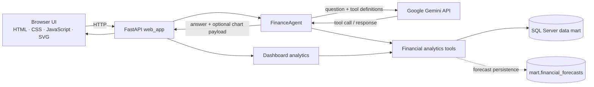

# AI Finance Analyst Agent

An AI-assisted finance analysis application that answers natural-language questions using validated analytics against a SQL Server financial data mart. It combines a bilingual executive dashboard with a conversational analyst powered by Google Gemini and deterministic financial tools.

The repository is an evolving project. Results depend on the configured database, its available data, and the model response; this software is not audited financial advice.

## Key Features

- **Executive dashboard:** currency and period filters, financial KPIs, monthly trends, period comparisons, cash-flow drivers, anomaly analysis, financial ratios, and a forecast outlook.
- **Natural-language Copilot:** asks the configured Gemini model to select from the enabled financial tools; tool results are validated before they are used in the response.
- **English and Arabic UI:** includes right-to-left layout, light and dark themes, and localized interface text.
- **Data-grounded charts:** dashboard trends and eligible Copilot chart requests use values returned by the financial analytics tools and are drawn with inline SVG.
- **Forecasting:** monthly forecasts use a trailing moving average and identify their historical basis. Forecasts can also be saved and compared with actuals through the SQL forecast table.
- **Financial safeguards:** supported-currency validation, explicit separation of facts from interpretation, and checks against unsupported values and mixed-currency results.

Tool availability and results depend on the configured SQL Server schema and the underlying data. The application does not ship with a private financial dataset.

## How It Works

1. The browser loads the FastAPI dashboard and sends chat questions to `POST /api/chat`.
2. The route resolves session and language context, then calls `FinanceAgent`.
3. The agent sends the question and enabled tool definitions to the configured Gemini model. The model may request a financial tool, and the agent normalizes and validates its arguments.
4. Financial tools query the configured SQL Server data mart. The agent validates returned values and gives the model verified results for its explanation.
5. The API returns the answer, session messages, and (when a verified trend result supports a chart request) chart metadata and points. The browser renders the chart as SVG.

The dashboard also calls financial tools directly for its structured panels. Saving a forecast is a separate write operation to `mart.financial_forecasts`; it is not performed by the dashboard's ordinary analytics queries.

## Architecture



## Technology Stack

| Area | Technology |
|---|---|
| Language | Python 3.11+ |
| Web API and server-rendered page | FastAPI, Uvicorn, Jinja2 |
| Browser UI | HTML, CSS, vanilla JavaScript, inline SVG |
| Language model | Google Gemini via `google-genai` |
| Financial data access | SQL Server via `pyodbc` |
| Configuration | YAML and `python-dotenv` |
| Data and analysis utilities | pandas, NumPy, PyArrow, SQLAlchemy |
| Tests | Python `unittest` |

## Project Structure

```text
.
├── config/                         # Shared project settings
├── phase_01_data/notebooks/        # Dataset metadata notebook
├── phase_02_data_engineering/      # Transaction inspection, profiling, loading
├── phase_06_api/app/               # API phase dependency placeholder
├── phase_08_ai_agent/
│   ├── agent/                      # FinanceAgent orchestration and validation
│   ├── agent_config/               # Agent and model configuration
│   ├── migrations/                 # Review-only SQL migration for forecasts
│   ├── prompts/                    # Agent system prompt
│   ├── tests/                      # Forecast and dashboard regression tests
│   ├── tools/                      # Tool schemas and SQL-backed analytics
│   └── web_app/                    # FastAPI UI, static assets, templates
├── .env.example                    # Safe local configuration template
├── .gitignore
└── requirements.txt
```

## Requirements and Installation

- Windows, macOS, or Linux with Python 3.11 or newer.
- A SQL Server instance with the expected `AI_Finance` schemas/tables and an installed Microsoft ODBC driver for SQL Server.
- A Google Gemini API key for Copilot requests.

Create and activate a virtual environment from the repository root (PowerShell example):

```powershell
py -3.11 -m venv .venv
.\.venv\Scripts\Activate.ps1
python -m pip install --upgrade pip
python -m pip install -r requirements.txt
python -m pip install -r phase_08_ai_agent/web_app/requirements-web.txt
```

On macOS or Linux, activate with `source .venv/bin/activate` and use the same pip commands.

## Configuration

Copy the template and edit the local file:

```powershell
Copy-Item .env.example .env
```

The agent loads `GEMINI_API_KEY` from the repository-root `.env`. SQL connectivity supports these variables:

| Variable | Purpose | Default |
|---|---|---|
| `AI_FINANCE_SQL_SERVER` | SQL Server host/instance; overrides `SQL_SERVER` | `localhost` |
| `SQL_SERVER` | Shared SQL Server host/instance | `localhost` |
| `AI_FINANCE_SQL_DATABASE` | Database used by the Phase 8 tools | `AI_Finance` |
| `AI_FINANCE_SQL_DRIVER` | Installed ODBC driver name | `ODBC Driver 18 for SQL Server` |
| `AI_FINANCE_SQL_TRUSTED_CONNECTION` | ODBC trusted connection setting | `yes` |
| `AI_FINANCE_SQL_ENCRYPT` | ODBC encryption setting | `no` |
| `AI_FINANCE_SQL_TRUST_SERVER_CERTIFICATE` | ODBC certificate trust setting | `yes` |
| `GEMINI_API_KEY` | Credential for Google Gemini requests | Required for Copilot |

The shared `config/settings.py` also reads `SQL_PORT`, `SQL_DATABASE`, `SQL_USERNAME`, `SQL_PASSWORD`, Hugging Face dataset settings, API host/port, generic LLM settings, `APP_ENV`, and `LOG_LEVEL`. The Phase 8 financial tools use the SQL variables listed above; configure the variables relevant to the component you run. Prefer a least-privilege SQL account and do not commit `.env` or real datasets.

The SQL forecast migration is at `phase_08_ai_agent/migrations/001_create_financial_forecasts.sql`. It is explicitly review-only and is not run by the application. Have a database owner review and apply it if forecast persistence is needed.

## Run the Application

From the repository root, with the environment activated:

```powershell
python -m uvicorn phase_08_ai_agent.web_app.web_app:app --reload
```

Or use the virtual environment interpreter directly:

```powershell
.\.venv\Scripts\python.exe -m uvicorn phase_08_ai_agent.web_app.web_app:app --reload
```

Open <http://127.0.0.1:8000>. The local command `& "D:\venv311\Scripts\python.exe" -m uvicorn phase_08_ai_agent.web_app.web_app:app --reload` is specific to one Windows machine and is not required for other installations.

## Example Questions

- “Summarize the available financial data and identify data-quality issues in USD.”
- “Analyze monthly net cash flow in USD from February to July 2026 and explain the trend.”
- “Compare actual cash flow in USD across the available periods.”
- “Identify potential financial risks and support each finding with available evidence.”
- “Generate a monthly net cash flow forecast in USD and distinguish forecast values from actuals.”
- “What should management prioritize based on the available data?”

Examples describe supported tool workflows; they do not guarantee data exists for the requested periods or metrics. Currency-specific numeric aggregations require one supported currency.

## Testing and Validation

Run the Phase 8 regression tests with the project interpreter:

```powershell
python -m unittest discover -s phase_08_ai_agent/tests -v
```

The tests cover tool argument/result contracts, forecast cutoffs and persistence behavior through mocks, chart and currency handling, and API/dashboard request behavior. Mocked tests do not establish that a live SQL Server, Gemini account, or complete production dataset is configured correctly.

## Data and Security Considerations

- Keep API keys, passwords, tokens, private connection strings, and real transaction datasets out of version control. `.env` is ignored; `.env.example` contains example values only.
- Copilot requests use the configured Gemini API. Do not submit confidential information unless your organization has approved that data flow and the provider configuration.
- SQL analytics depend on the configured database. The enabled `save_financial_forecast` tool writes forecast records to `mart.financial_forecasts`; review SQL permissions and the migration before enabling persistence.
- Use a least-privilege database account and synthetic, public, or otherwise authorized data for demonstrations.
- Validate important financial conclusions against source data and applicable business controls.

## Current Limitations

- The app requires an appropriately configured SQL Server schema and does not include private financial data.
- Copilot requires a valid Gemini API key and network access to the configured Google API.
- Forecasting currently uses a trailing moving-average method; its output is a forecast and not an observed actual.
- Forecast persistence requires the separately reviewed `mart.financial_forecasts` table.
- Automated unit tests use mocks for database and model integrations; live integration and visual verification are environment-dependent.

## Roadmap

- Add documented, reproducible integration checks against a disposable SQL Server fixture.
- Add a sanitized demo dataset and repeatable local demo setup.
- Expand evaluation of tool selection, numerical correctness, and multilingual responses.
- Document deployment, monitoring, and operational controls.

## Author and Repository

**Maged Magdy**

Repository: <https://github.com/Magedmagdy/AI-Finance-Analyst-Agent>

## Disclaimer

This project is for learning and software development. It is not audited financial advice and should not be used for financial decisions without appropriate validation and review.
