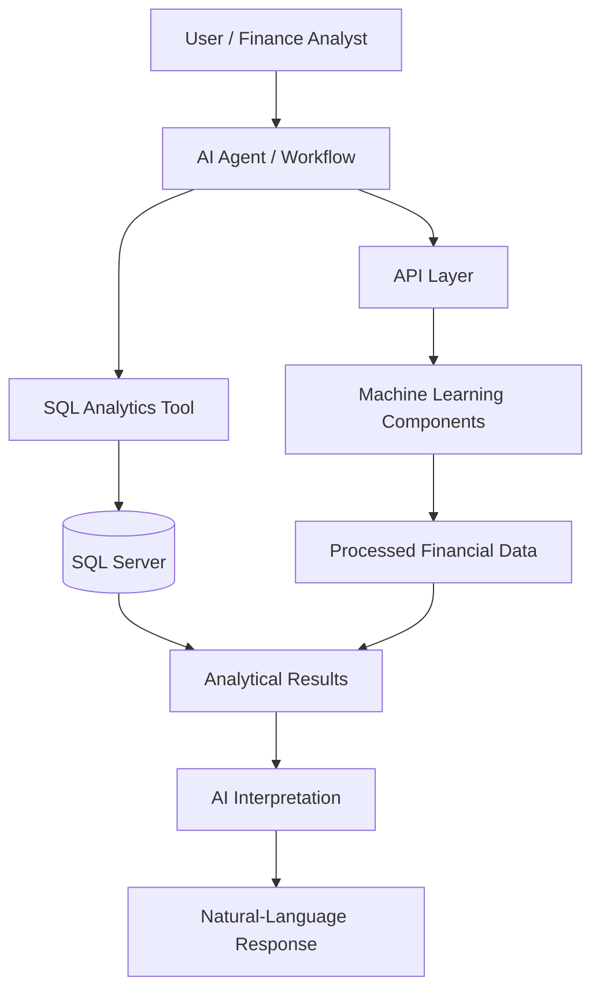

# AI Finance Analyst Agent

**An AI-powered financial analytics project combining data engineering, SQL Server, machine learning, APIs, and natural-language interaction.**

[](https://www.python.org/)
[](https://www.microsoft.com/en-us/sql-server)
[](https://github.com/Magedmagdy/AI-Finance-Analyst-Agent)
[](https://github.com/Magedmagdy/AI-Finance-Analyst-Agent)

## Overview

The **AI Finance Analyst Agent** explores how AI can make financial data easier to query, analyze, and interpret.

The project brings together a data-processing foundation, SQL Server integration, API and machine-learning components, and an AI-agent workflow intended to support finance-oriented questions and analytical tasks.

The objective is to move beyond static reports toward a more interactive analytical experience—where users can ask questions in natural language and receive insights grounded in financial data.

> **Project status:** This repository is an evolving technical project. Component availability, configuration, and validation may vary. It is not presented as a production-ready financial system.

## Key Capabilities and Goals

- **Financial data engineering** — prepare and process transaction datasets for downstream analysis.
- **SQL-based analytics** — connect analytical workflows to SQL Server data.
- **Financial KPIs** — support the development of metrics and financial summaries.
- **AI-assisted analysis** — explore natural-language interaction with financial information.
- **Machine-learning integration** — provide a foundation for prediction and anomaly-analysis workflows.
- **API architecture** — organize analytical capabilities behind service interfaces.
- **Workflow orchestration** — explore connecting tools and agent workflows through n8n.
- **Retrieval-Augmented Generation (RAG)** — explore grounding AI responses in relevant data or retrieved context.

These capabilities describe the project's scope and direction; they should not be interpreted as a guarantee that every workflow is fully implemented, independently validated, or production-ready.

## High-Level Architecture



The diagram represents the intended high-level flow. The exact integration between components depends on their implementation and runtime configuration.

## Technology Stack

| Area | Technologies |
|---|---|
| Programming | Python |
| Data processing | pandas, NumPy, PyArrow |
| Database | Microsoft SQL Server, pyodbc, SQLAlchemy |
| Data exploration | Jupyter Notebook |
| API layer | FastAPI-related project components |
| AI and language models | LLM-based workflows |
| Orchestration | n8n |
| AI retrieval approach | RAG |
| Configuration | Environment variables, `python-dotenv` |
| Dataset access | Hugging Face dataset tooling |

## Repository Structure

```text
AI-Finance-Analyst-Agent/
├── config/
│   └── Application configuration
├── phase_01_data/
│   └── notebooks/
│       └── Data exploration and analysis
├── phase_02_data_engineering/
│   └── scripts/
│       └── Data loading, profiling, and preparation
├── phase_06_api/
│   └── app/
│       └── API application components
├── phase_08_ai_agent/
│   └── AI agent, tools, prompts, and interface components
├── .env.example
├── .gitignore
├── requirements.txt
└── README.md
```

The repository is organized into phases to separate data exploration, data engineering, API development, and AI-agent functionality.

## Getting Started

### 1. Prerequisites

Before running the project, prepare the following as needed for the component you want to use:

- Python 3.11 or a compatible Python version.
- Git.
- Microsoft SQL Server and an appropriate SQL Server ODBC driver for database workflows.
- Access to the required financial dataset.
- Credentials for any external LLM or other services used by the selected workflow.
- n8n, if you intend to run the related orchestration workflow.

### 2. Clone the Repository

```bash
git clone https://github.com/Magedmagdy/AI-Finance-Analyst-Agent.git
cd AI-Finance-Analyst-Agent
```

### 3. Create a Virtual Environment

**Windows PowerShell**

```powershell
py -3.11 -m venv .venv
.\.venv\Scripts\Activate.ps1
```

If PowerShell blocks script activation, you can use the virtual environment's Python executable directly instead of changing system execution-policy settings.

### 4. Install the Base Dependencies

```powershell
python -m pip install --upgrade pip
pip install -r requirements.txt
```

The root requirements file provides baseline data-processing, notebook, SQL Server, and environment-configuration packages. Additional dependencies may be required for individual API, AI-agent, or interface components.

### 5. Configure Environment Variables

Create a local `.env` file from the supplied template:

```powershell
Copy-Item .env.example .env
```

Edit `.env` with values appropriate for your environment.

Typical settings include:

```dotenv
SQL_SERVER=localhost
SQL_PORT=1433
SQL_DATABASE=AI_Finance
SQL_USERNAME=
SQL_PASSWORD=

HF_DATASET_REPO=ziadatalabs/FreeFinancialTransactions50M
HF_DATASET_FILE=transactions_50M.parquet

API_HOST=127.0.0.1
API_PORT=8000

LLM_PROVIDER=
LLM_MODEL=
LLM_API_KEY=

APP_ENV=development
LOG_LEVEL=INFO
```

These are example configuration values, not credentials or a guarantee that every component reads every variable. Review the relevant source code before running a workflow, and never commit your real `.env` file.

### 6. Prepare the Data Source

Before executing data-engineering scripts:

1. Review the scripts under `phase_02_data_engineering/scripts/`.
2. Verify the dataset location and update any machine-specific file paths for your environment.
3. Configure SQL Server connectivity and confirm that the target database and required permissions are available.
4. Use an authorized dataset and verify its schema before loading data.

Do not assume that downloading the repository alone supplies the underlying financial dataset or configures your local database.

### 7. Run Individual Components

Start with the notebooks or scripts relevant to the workflow you want to explore. For the API and AI-agent components, inspect their entry points and required packages before starting services.

A complete, verified end-to-end installation command is not yet documented in this README. Setup instructions will be refined as the individual components are validated across environments.

## Security and Responsible Use

Financial data can contain sensitive information. Please follow these precautions:

- Never commit API keys, passwords, access tokens, or private connection strings.
- Keep `.env` files and local datasets out of version control.
- Use synthetic, public, or explicitly authorized financial data for demonstrations.
- Avoid publishing confidential transaction details, account identifiers, or internal business information.
- Validate AI-generated calculations and explanations against the underlying data.
- Treat model-generated insights as analytical assistance, not as a substitute for professional financial judgment.

## Current Limitations

- Local data paths and database settings may need to be adapted before running the scripts.
- Different components may have separate dependency and service requirements.
- End-to-end setup and validation are still being documented.
- Forecasting, anomaly detection, and AI-generated analysis require task-specific evaluation before being used for real financial decisions.

## Roadmap

- [ ] Document setup and execution for each project component.
- [ ] Standardize configuration across data, API, and agent layers.
- [ ] Add reproducible example data and end-to-end usage examples.
- [ ] Add automated tests for analytical tools and data-processing workflows.
- [ ] Evaluate analytical correctness and AI response reliability.
- [ ] Add sanitized screenshots and a public demo walkthrough.
- [ ] Document deployment, monitoring, and operational safeguards.

## Why This Project?

This project is part of an exploration of the intersection between **Business Intelligence, Data Engineering, Machine Learning, and Generative AI**.

The broader goal is to build systems that make analytical data more accessible while keeping the underlying data processing, calculations, and limitations visible to the people using them.

## Author

**Maged Magdy**

Explore more of my work on [GitHub](https://github.com/Magedmagdy).

## Disclaimer

This repository is intended for learning, experimentation, and software development. It does not provide audited financial advice, and it should not be used for financial decisions without appropriate validation, controls, and review.
