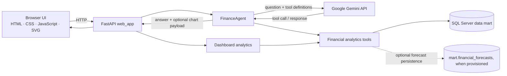

# AI Finance Analyst Agent

An AI-assisted finance analysis application that answers natural-language questions using validated analytics against a SQL Server financial data mart. It combines a bilingual executive dashboard with a conversational analyst powered by Google Gemini and deterministic financial tools.

The repository is an evolving project. Results depend on the configured database, its available data, and the model response; this software is not audited financial advice.

## Contents

- [Project Overview](#project-overview)
- [Key Features](#key-features)
- [Pages and Routes](#pages-and-routes)
- [Financial Audit Trail and Metric Explorer](#financial-audit-trail-and-metric-explorer)
- [What-If Financial Simulator](#what-if-financial-simulator)
- [How It Works](#how-it-works)
- [Architecture and Data Sources](#architecture-and-data-sources)
- [Project Structure](#project-structure)
- [Installation and Configuration](#installation-and-configuration)
- [Run the Application](#run-the-application)
- [Testing and Validation](#testing-and-validation)
- [Limitations and Data Security](#limitations-and-data-security)
- [Roadmap](#roadmap)
- [Author and Repository](#author-and-repository)

## Project Overview

AI Finance Analyst Agent is a financial analytics and decision-support application. It combines a bilingual dashboard, deterministic SQL-backed analysis, interactive visualizations, and a Gemini-powered conversational interface. It is an evolving project, not a production-certified financial system; results depend on the configured data sources, their coverage and quality, and the model response.

## Key Features

- **Financial dashboard:** currency and month filters, KPI summaries, monthly cash-flow trends, period comparisons, cash-flow drivers, reconciliation checks, and statistical observations.
- **AI Finance Analyst Assistant:** a separate conversational page; the Dashboard remains the application home page. The assistant uses the configured Gemini model with enabled financial tools, with code-level checks on tool arguments and results.
- **English and Arabic UI:** includes right-to-left layout, light and dark themes, and localized interface text.
- **Data-driven visualizations:** the dashboard trend, simulator comparison, and eligible assistant charts render from available results. The Root Cause Analysis waterfall and assistant mind map support user interaction.
- **Interactive analysis mind map:** eligible Copilot answers include a selectable, expandable SVG map built from validated tool results, with evidence details and RTL/LTR support. Unsupported recommendations are not synthesized.
- **Financial Health Monitor:** presents available financial observations, comparisons, trend context, forecast status, and data coverage without manufacturing an overall financial score.
- **Financial Alert Center:** derives performance observations, configured anomaly observations, and reconciliation records from current dashboard analysis. Review workflow statuses are not persistently stored.
- **Cash Flow Outlook:** provides a monthly net-cash-flow forecast and its historical basis.
- **Root Cause Analysis:** compares the selected month with the preceding month and shows transaction-type movements plus any reconciliation residual.
- **What-If Simulator:** models expense-change sensitivities against actual net cash flow; see [supported assumptions and limitations](#what-if-financial-simulator).
- **Financial Metric Explorer:** catalogs implemented metrics and distinguishes actuals, forecast values, and simulation definitions.
- **PDF report export:** downloads the latest available structured assistant analysis for the current session; it is not a PDF export of every dashboard view.
- **Forecasting:** the dashboard forecast uses a trailing moving average over completed monthly observations. The assistant also exposes forecast save/retrieval tools; saving requires the database object and permissions to be provisioned.
- **Financial safeguards:** supported-currency validation, explicit separation of facts from interpretation, and checks against unsupported values and mixed-currency results.

Tool availability and results depend on the configured SQL Server schema and the underlying data. The application does not ship with a private financial dataset.

## Pages and Routes

| Route | Page or view |
|---|---|
| `/` | Main financial dashboard |
| `/assistant` | Separate AI Finance Analyst Assistant |
| `/health-monitor` | Financial Health Monitor view |
| `/alerts` | Financial Alert Center |
| `/cash-flow-outlook` | Cash Flow Outlook view |
| `/root-cause` | Root Cause Analysis view |
| `/what-if` | Financial What-If Simulator |
| `/metric-explorer` | Financial Metric Explorer |

The Dashboard, Health Monitor, Cash Flow Outlook, and Root Cause Analysis routes use views rendered from the dashboard template. The Assistant, Alert Center, What-If Simulator, and Metric Explorer have dedicated templates.

The web API also provides `GET /api/session`, `GET /api/dashboard`, `POST /api/chat`, `POST /api/reset`, `GET /api/export/report.pdf`, and `GET /api/health`. There is no separate persistent alert-workflow API in the current implementation.

## Financial Audit Trail and Metric Explorer

The Metric Explorer builds a catalog from metrics registered in the application code and transaction-type drivers returned by a successful root-cause analysis. Users can search the catalog and filter it by **Actual**, **Forecast**, or **Simulation**. Metric details include an available value, currency, period, source, calculation description, filters, interpretation limits, and a code-traceability status when supported.

The catalog distinguishes similarly named measures when their source or aggregation differs. For example, the `fees` KPI is aggregated from the daily KPI mart, while an RCA fee row is a signed transaction-type component from the transaction view. The page does not expose transaction-level records or SQL statements. A “Verified in code” or similar status indicates code traceability only; it is not independent accounting verification or proof of live-data reconciliation. A Simulation entry describes a supported calculation and does not imply that a scenario value is included in the Dashboard API response.

## What-If Financial Simulator

The simulator compares a selected-period actual baseline with expense-change scenarios using this calculation:

```text
Simulated Net Cash Flow = Actual Net Cash Flow - (Actual Outflows × Expense Change % / 100)
```

The baseline net cash flow and outflows come from the existing financial KPI response. The interface includes built-in expense sensitivities and custom scenarios; assumptions are kept in browser `sessionStorage` for the current tab session and are not saved to the financial database. This is a sensitivity calculation, **not a forecast**.

Revenue-change assumptions are not applied because the available data does not establish recognized revenue separately from cash inflows. Collection-delay scenarios are unsupported because receivables aging, due dates, and a collection schedule are unavailable. The model holds other financial responses constant.

## How It Works

1. The browser loads a page route. Analytical pages request structured data through `GET /api/dashboard`; chat questions are sent to `POST /api/chat`.
2. The route resolves session and language context, then calls `FinanceAgent`.
3. The agent sends the question and enabled tool definitions to the configured Gemini model. The model may request a financial tool, and the agent normalizes and validates its arguments.
4. Financial tools query configured SQL Server sources. The agent checks tool arguments and results against supported metric, period, currency, and result contracts before using results as evidence for an explanation.
5. The API returns the answer and session messages, plus optional chart and mind-map data when validated results support them. The browser renders those visualizations as SVG; the mind map omits claims that are not present in verified tool results.

The dashboard calls financial tools directly for its structured panels. Dashboard analytics use read queries. Forecast persistence is a separate assistant tool operation against `mart.financial_forecasts`, not part of an ordinary dashboard refresh.

## Architecture and Data Sources

The Phase 8 application uses FastAPI and Jinja2 for web routes and templates, vanilla JavaScript and CSS for the browser UI, and Python financial tools for deterministic calculations. Financial tools read KPI aggregates from `mart.daily_financial_kpis` and transaction-derived measures or transaction-type components from `core.vw_transactions`. Metrics do not all come from both sources; the Metric Explorer describes the source and calculation when they are traceable in code.

The conversational assistant uses Google Gemini tool calling with the configured model. The model may select or request tools; financial values are calculated by application code and SQL queries rather than generated by the language model. Statistical daily cash-flow observations use a modified Z-score/MAD method and are not fraud findings.



## Technology Stack

| Area | Technology |
|---|---|
| Language | Python 3.11+ |
| Web API and server-rendered page | FastAPI, Uvicorn, Jinja2 |
| Browser UI | HTML, CSS, vanilla JavaScript, inline SVG |
| Language model | Google Gemini via `google-genai` |
| Financial data access | SQL Server via `pyodbc` |
| Configuration | YAML and `python-dotenv` |
| Data and analysis utilities | pandas, NumPy, PyArrow, SQLAlchemy |
| Tests | Python `unittest` |

## Project Structure

```text
.
├── config/                         # Shared project settings
├── phase_01_data/notebooks/        # Dataset metadata notebook
├── phase_02_data_engineering/      # Transaction inspection, profiling, loading
├── phase_06_api/app/               # API-phase dependency file
├── phase_08_ai_agent/
│   ├── agent/                      # FinanceAgent orchestration and validation
│   ├── agent_config/               # Agent and model configuration
│   ├── prompts/                    # Agent system prompt
│   ├── tests/                      # Python and standalone frontend regression tests
│   ├── tools/                      # Tool schemas and SQL-backed analytics
│   └── web_app/                    # FastAPI routes, report export, static assets, templates
├── .env.example                    # Safe local configuration template
├── .gitignore
└── requirements.txt
```

## Installation and Configuration

- Windows, macOS, or Linux with Python 3.11 or newer.
- A SQL Server instance with the expected `AI_Finance` schemas/tables and an installed Microsoft ODBC driver for SQL Server.
- A Google Gemini API key for Copilot requests.

Create and activate a virtual environment from the repository root (PowerShell example):

```powershell
py -3.11 -m venv .venv
.\.venv\Scripts\Activate.ps1
python -m pip install --upgrade pip
python -m pip install -r requirements.txt
python -m pip install -r phase_08_ai_agent/web_app/requirements-web.txt
```

On macOS or Linux, activate with `source .venv/bin/activate` and use the same pip commands.

## Configuration

Copy the template and edit the local file:

```powershell
Copy-Item .env.example .env
```

The assistant loads `GEMINI_API_KEY` from the repository-root `.env`. Phase 8 SQL connectivity reads these variables when its financial-tools module is imported:

| Variable | Purpose | Configuration |
|---|---|---|
| `AI_FINANCE_SQL_SERVER` | Phase 8 SQL Server host/instance; takes precedence over `SQL_SERVER` | Environment-specific |
| `SQL_SERVER` | Fallback SQL Server host/instance | Environment-specific |
| `AI_FINANCE_SQL_DATABASE` | Database used by the Phase 8 tools | Configure locally |
| `AI_FINANCE_SQL_DRIVER` | Installed Microsoft ODBC driver name | Configure locally |
| `AI_FINANCE_SQL_TRUSTED_CONNECTION` | Windows/ODBC trusted-connection option | Configure locally |
| `AI_FINANCE_SQL_ENCRYPT` | ODBC transport-encryption option | Configure to match server security policy |
| `AI_FINANCE_SQL_TRUST_SERVER_CERTIFICATE` | ODBC server-certificate validation option | Configure to match server certificate setup |
| `GEMINI_API_KEY` | Credential for Google Gemini requests | Required for assistant requests |

The shared `config/settings.py` also reads `SQL_PORT`, `SQL_DATABASE`, `SQL_USERNAME`, `SQL_PASSWORD`, Hugging Face dataset settings, API host/port, generic LLM settings, `APP_ENV`, and `LOG_LEVEL`. The Phase 8 financial tools use the Phase 8 SQL variables above; configure the settings relevant to the component you run. Prefer least-privilege database access and never commit `.env` or real datasets. Review encryption and certificate options against the SQL Server's security configuration; the example template is not a production security recommendation.

The application does not create or migrate the forecast table automatically. Forecast persistence requires the expected database object and appropriate permissions to be provisioned separately by a database administrator.

## Run the Application

From the repository root, with the environment activated:

```powershell
python -m uvicorn phase_08_ai_agent.web_app.web_app:app --reload
```

Or use the virtual environment interpreter directly:

```powershell
.\.venv\Scripts\python.exe -m uvicorn phase_08_ai_agent.web_app.web_app:app --reload
```

Open <http://127.0.0.1:8000> in a browser.

## Example Questions

- “Summarize the available financial data and identify data-quality issues in USD.”
- “Analyze monthly net cash flow in USD across the available months and explain the trend.”
- “Compare actual cash flow in USD across the available periods.”
- “Summarize unusual-activity observations and reconciliation issues with their available evidence.”
- “Generate a monthly net cash flow forecast in USD and distinguish forecast values from actuals.”
- “What should management prioritize based on the available data?”

Examples describe supported tool workflows; they do not guarantee data exists for the requested periods or metrics. Currency-specific numeric aggregations require one supported currency.

## Testing and Validation

Run the Phase 8 regression tests with the project interpreter:

```powershell
python -m unittest discover -s phase_08_ai_agent/tests -v
```

The repository includes Python `unittest` coverage for tool argument/result contracts, period and currency validation, forecast behavior, dashboard and navigation routes, and report export. Database and model behavior in those tests is mocked where indicated by the tests; those tests do not establish that a live service is reachable. Run the standalone frontend regression checks with Node.js (18 or newer is recommended):

```powershell
node phase_08_ai_agent/tests/what_if_frontend.test.cjs
node phase_08_ai_agent/tests/metric_explorer_frontend.test.cjs
node phase_08_ai_agent/tests/mind_map_frontend.test.cjs
node phase_08_ai_agent/tests/alert_center_frontend.test.cjs
node phase_08_ai_agent/tests/dashboard_sections_frontend.test.cjs
node phase_08_ai_agent/tests/dashboard_metric_links_frontend.test.cjs
node phase_08_ai_agent/tests/financial_health_monitor_frontend.test.cjs
```

These commands describe the available test suite; no test results are asserted by this README. Passing mocked or local tests does not establish that a live SQL Server, Gemini account, or complete production dataset is configured correctly. Manual browser validation and live financial-data reconciliation are separate checks.

## Limitations and Data Security

- Keep API keys, passwords, tokens, private connection strings, and real transaction datasets out of version control. `.env` is ignored; `.env.example` contains example values only.
- Copilot requests use the configured Gemini API. Do not submit confidential information unless your organization has approved that data flow and provider configuration.
- SQL results depend on the configured database, its coverage, and source-data quality. Code-level metric traceability is not independent accounting audit certification or proof of live reconciliation.
- Statistical unusual-activity observations are not fraud findings or automatic risk classifications.
- Forecasts use a trailing moving-average method over completed months and are not actual results. What-If scenarios are expense sensitivities, not forecasts.
- Alert Center workflow status is currently shown as not tracked; the page does not persist reviewer status or notes.
- The assistant's `save_financial_forecast` tool can write forecast records to `mart.financial_forecasts`; review database permissions and provision the expected table before using that operation. Dashboard refreshes do not perform this write.
- Use a least-privilege database account and synthetic, public, or otherwise authorized data for demonstrations.
- Validate important financial conclusions against source data and applicable business controls.

## Roadmap

- Potentially add macroeconomic impact and FX sensitivity when verified exchange-rate and economic data sources are available.
- Add forecast accuracy monitoring against subsequent actuals.
- Expand scenario modeling only where required financial inputs and assumptions are supported.
- Improve reproducible financial validation and reconciliation against approved source data.
- Add documented, reproducible integration checks against a disposable SQL Server fixture.
- Add a sanitized demo dataset and repeatable local demo setup.
- Expand evaluation of tool selection, numerical correctness, and multilingual responses.
- Document deployment, monitoring, and operational controls.

## Author and Repository

**Maged Magdy**

Repository: <https://github.com/Magedmagdy/AI-Finance-Analyst-Agent>

## Disclaimer

This project is for learning and software development. It is not audited financial advice and should not be used for financial decisions without appropriate validation and review.
